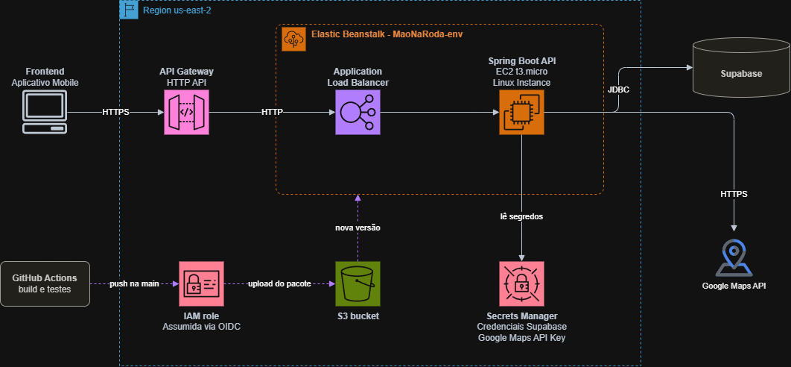

# Mão na Roda

O planejamento de visitante com Google Routes e mapa Android está implementado para
configuração e validação em ambiente de teste. Consulte o
[registro da migração e teste local](docs/16-migracao-google-routes.md), o
[guia da API](apps/api/PLANEJAMENTO.md) e o [guia Android](apps/android/README.md).
O backend ainda precisa ser configurado e iniciado; ativar a Routes API no Google
Cloud, por si só, não conecta o aplicativo.

Para o time preparar o ambiente e executar o aceite, consulte o
[guia de testes, bloqueios atuais e responsabilidades](docs/17-guia-testes-time.md).

Aplicativo para ajudar pessoas com mobilidade reduzida a encontrar rotas considerando as condições de acessibilidade dos trajetos e barreiras relatadas por usuários.

## Sobre o projeto

O Mão na Roda propõe apoiar pessoas com mobilidade reduzida na consulta de rotas mais compatíveis com suas necessidades. A solução considera perfis de mobilidade, informações sobre barreiras nos trajetos e relatos enviados por usuários.

Na primeira versão, o foco é consultar informações de acessibilidade e receber relatos. A validação dos relatos e seu uso para alterar as rotas estão previstos para uma etapa posterior, conforme as regras de negócio aprovadas.

## Origem

O projeto surgiu durante a 6ª WECTI da UNICID, em uma apresentação de MVPs. Na ocasião, nosso grupo apresentou o pitch de uma ideia de aplicativo voltado a alunos, professores e visitantes da faculdade. A proposta conquistou o 1º lugar entre as apresentações do dia. Esse reconhecimento nos motivou a dar continuidade à ideia, tirá-la do papel e transformá-la em realidade.

Desde então, a proposta evoluiu e passou a investigar como informações sobre barreiras de acessibilidade podem ajudar pessoas com mobilidade reduzida a planejar seus deslocamentos.

## Integrantes

| Integrante | Linkedin/Github | Responsabilidade |
|---|---|---|
| **Arthur** | https://www.linkedin.com/in/arthur-oshiro-b81392341/ | Administrador do banco de dados |
| **Guilherme** | https://www.linkedin.com/in/luiz-guilherme-rom%C3%A3o-85646b35b/ | Desenvolvedor UI/UX do aplicativo |
| **Felipe** | https://www.linkedin.com/in/felipe-filho-3574a4173/ | Desenvolvedor da API |
| **Pablo** | https://www.linkedin.com/in/pablo-calegari-997a40234/ | Desenvolvedor das funcionalidades do aplicativo |
| **Rafael** | https://www.linkedin.com/in/rafaelboregs/ | Líder e auxílio geral |

## Estrutura atual do repositório

A árvore abaixo representa a estrutura atual do repositório.

```text
.
├── .github/
│   ├── ISSUE_TEMPLATE/                  # Modelos de issues
│   ├── workflows/                       # CI/CD: Android e API (Elastic Beanstalk)
│   └── pull_request_template.md         # Modelo de pull request
├── apps/
│   ├── android/                         # Aplicativo Android nativo
│   │   ├── app/src/main/java/           # Código Java do aplicativo
│   │   └── app/src/main/res/            # Layouts, estilos e recursos XML
│   └── api/                             # API Java com Spring Boot
│       ├── database/                    # Documentação, testes SQL e carga do piloto
│       ├── deploy/                      # Procfile da implantação
│       ├── tools/                       # Scripts de teste com PostGIS
│       ├── src/
│       │   ├── main/
│       │   │   ├── java/                # Código-fonte da API
│       │   │   └── resources/
│       │   │       ├── application*.properties
│       │   │       └── db/migration/    # Migrations Flyway (fonte da verdade)
│       │   │           ├── 25-10/       # V1–V5
│       │   │           └── 01-11/       # V6
│       │   └── test/
│       │       └── java/                # Testes da API
│       ├── compose.test.yml
│       ├── pom.xml
│       └── README.md
├── database/
│   └── migrations/                      # Cópia de referência dos SQLs aplicados manualmente em produção
├── docs/
│   ├── 01-visao-de-negocio.md
│   ├── 02-regras-de-negocio.md
│   ├── 03-requisitos.md
│   ├── 04-casos-de-uso.md
│   ├── 05-tech-stack.md
│   ├── 06-banco-de-dados.md
│   ├── 07-analise-de-aplicativos.md
│   ├── 08-implantacao-aws.md
│   ├── 12-diagnostico-e-proximas-entregas.md
│   ├── 13-registro-implementacao-rotas.md
│   ├── 14-publicacao-e-validacao-remota.md
│   ├── 15-correcao-sincronizacao-android-studio.md
│   ├── 16-migracao-google-routes.md
│   ├── 17-guia-testes-time.md
│   └── piloto/                          # Corpus do piloto de rotas
├── CONTRIBUTING.md
└── README.md
```

### Responsabilidade de cada área

- `apps/android/`: aplicativo Android nativo, com Java, layouts e estilos XML.
- `apps/api/`: endpoints, autenticação/autorização, regras de negócio e integração com o banco e serviços externos.
- `apps/api/src/main/resources/db/migration/`: migrations Flyway para PostgreSQL/PostGIS e carga inicial da matriz de barreiras. É a **fonte da verdade** do banco; os arquivos ficam em subpastas pela data de criação (`25-10/`, `01-11/`). Novas mudanças entram como `V7__...sql` em diante.
- `database/migrations/`: cópia de referência dos SQLs equivalentes a V1–V6, aplicados manualmente no SQL Editor do Supabase de produção. Não evoluir esses arquivos nem executá-los em ambientes novos; use o Flyway.
- `apps/api/database/`: documentação operacional do banco e testes SQL locais.
- `docs/`: visão, regras, requisitos, casos de uso, decisões técnicas e modelo de dados.
- `.github/`: modelos e automações relacionados a issues e pull requests.

## Arquitetura e Deploy
A API Spring Boot roda no Elastic Beanstalk (us-east-2). O frontend acessa apenas a URL do API Gateway, e o deploy é feito pelo GitHub Actions.



### Componentes
 
| Componente | Função |
|---|---|
| API Gateway (HTTP API) | Ponto de entrada público. |
| Application Load Balancer | Recebe o tráfego do API Gateway. |
| EC2 (t3.micro, Linux) | Instância do Beanstalk que roda nginx e a API Spring Boot. |
| Secrets Manager | Guarda as credenciais do Supabase e a chave da Google Maps API. |
| S3 | Bucket criado pelo Beanstalk, recebe o pacote de cada deploy. |
| IAM role | Assumida pelo GitHub Actions via OIDC, sem chaves de longa duração. |
| Supabase | Banco Postgres, acessado via pooler (JDBC). |
| Google Maps API | Chamada somente pelo backend. |

### Fluxo de deploy
 
1. Um push na `main` executa os testes e empacota o JAR (`application.jar` + `Procfile`).
2. O workflow assume a IAM role via OIDC.
3. O pacote é enviado ao bucket S3 e o ambiente do Beanstalk é atualizado com a nova versão.
4. A última etapa confirma que `/actuator/health` responde `UP` pela URL pública.


## Tecnologias

As tecnologias documentadas atualmente incluem:

- **Aplicativo:** Android nativo, Java, XML, AndroidX e Material Components.
- **API:** Java com Spring Boot.
- **Banco de dados:** PostgreSQL com PostGIS, hospedado no Supabase.
- **Autenticação e armazenamento:** Supabase Auth e Supabase Storage.
- **Migrations:** Flyway Maven Plugin, executado a partir de `apps/api/`.

Consulte [`docs/05-tech-stack.md`](docs/05-tech-stack.md) para decisões e pendências técnicas. Para o banco, consulte também [`apps/api/database/README.md`](apps/api/database/README.md).

## Documentação

- [Aplicativo Android](apps/android/README.md)
- [API](apps/api/README.md)
- [Banco de dados e migrations](apps/api/database/README.md)
- [Visão de negócio](docs/01-visao-de-negocio.md)
- [Regras de negócio](docs/02-regras-de-negocio.md)
- [Requisitos](docs/03-requisitos.md)
- [Casos de uso](docs/04-casos-de-uso.md)
- [Tech stack](docs/05-tech-stack.md)
- [Banco de dados](docs/06-banco-de-dados.md)
- [Análise de aplicativos](docs/07-analise-de-aplicativos.md)
- [Implantação na AWS](docs/08-implantacao-aws.md)
- [Diagnóstico e próximas entregas](docs/12-diagnostico-e-proximas-entregas.md)
- [Registro da implementação de mapas e rotas](docs/13-registro-implementacao-rotas.md)
- [Publicação e validação remota](docs/14-publicacao-e-validacao-remota.md)
- [Correção da sincronização no Android Studio](docs/15-correcao-sincronizacao-android-studio.md)
- [Migração para Google Routes](docs/16-migracao-google-routes.md)
- [Guia de testes de rotas para o time](docs/17-guia-testes-time.md)

## Como contribuir

1. Consulte a documentação antes de implementar ou alterar uma regra do produto.
2. Abra uma issue descrevendo o problema ou a mudança proposta.
3. Crie uma branch com um nome relacionado à tarefa.
4. Faça commits objetivos e abra um pull request usando o modelo do repositório.
5. Atualize a documentação quando uma alteração modificar requisitos, regras de negócio ou decisões técnicas.

Consulte [`CONTRIBUTING.md`](CONTRIBUTING.md) para as convenções completas de contribuição.

## Licença

A licença do projeto ainda precisa ser definida. Até lá, não presuma que o código pode ser reutilizado ou redistribuído.
