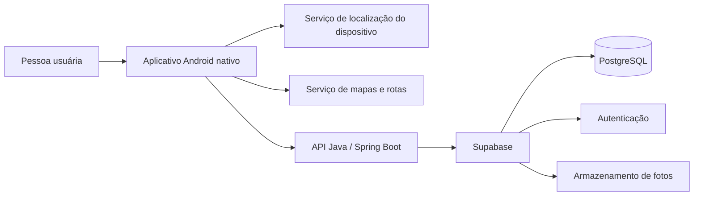

# Tech Stack – Mão na Roda

> **Versão do documento:** 0.7  
> **Data:** 15/10/2026  
> **Última atualização:** 09/11/2026  
> **Documentos relacionados:** [Visão de negócio](01-visao-de-negocio.md) · [Regras de negócio](02-regras-de-negocio.md) · [Requisitos](03-requisitos.md) · [Casos de uso](04-casos-de-uso.md)

---

## 1. Objetivo

Este documento registra as tecnologias previstas para a V1 do Mão na Roda, a responsabilidade de cada uma e as decisões que ainda precisam de validação.

A arquitetura da V1 prioriza uma implementação viável para uma equipe pequena: o aplicativo concentra a experiência da pessoa usuária; a API em Java concentra as regras de negócio; e o Supabase reduz o trabalho de infraestrutura ao oferecer banco PostgreSQL, autenticação e armazenamento de arquivos.

---

## 2. Visão geral da arquitetura

| Componente | Responsabilidade |
|---|---|
| Aplicativo Android nativo | Exibir mapa, receber ações da pessoa usuária, solicitar permissões, apresentar rotas e permitir o envio de relatos. |
| API Java | Aplicar regras de negócio, calcular a classificação das barreiras, proteger operações autenticadas e integrar os serviços necessários. |
| Supabase | Fornecer PostgreSQL gerenciado, autenticação de contas e armazenamento das fotos enviadas em relatos. |
| Serviço de mapas e rotas | Google Maps SDK desenha o mapa no Android; Google Routes fornece ao backend as rotas-base a pé, resolvendo endereços na própria consulta. |

---

## 3. Tecnologias

| Camada | Tecnologia | Papel no projeto | Status |
|---|---|---|---|
| Aplicativo móvel | Android nativo, Java e layouts XML | Desenvolver a interface Android com AndroidX e Material Components, com acessibilidade e suporte futuro a localização. | Em desenvolvimento |
| Backend | Java com Spring Boot | Expor a API REST e centralizar as regras de rotas, relatos, contas e autorização. | Aprovado |
| API | REST com JSON | Permitir a comunicação entre o aplicativo e o backend. | Aprovado |
| Banco de dados | PostgreSQL, gerenciado pelo Supabase | Armazenar contas, perfis de mobilidade, relatos, confirmações futuras e dados de acessibilidade. | Aprovado |
| Autenticação | Supabase Auth | Criar contas, iniciar sessões e emitir tokens para acesso às operações autenticadas. | Aprovado |
| Armazenamento de fotos | Supabase Storage | Armazenar imagens anexadas aos relatos e removê-las após o prazo definido para contas excluídas. | Aprovado |
| Mapa no aplicativo | Google Maps SDK for Android | Exibir o mapa e desenhar as rotas retornadas pela API. | Aprovado |
| Rotas-base e endereços | Google Routes API (modo `WALK`) | Obter candidatas de rota a pé entre endereços ou coordenadas, chamada somente pelo backend. | Aprovado; homologação com trajetos reais pendente |
| Migrations | Flyway Maven Plugin | Versionar e aplicar o schema PostgreSQL/PostGIS a partir de `apps/api`. | Aprovado |
| Hospedagem da API | AWS Elastic Beanstalk | Executar a API atrás de API Gateway e Application Load Balancer. | Em uso |
| Localização | APIs de localização do Android | Obter a localização atual somente após consentimento. | Aprovado |
| Documentação da API | OpenAPI/Swagger | Descrever e testar os endpoints da API. | Aprovado |
| Testes de backend | JUnit e Spring Boot Test | Validar regras de negócio, autenticação e endpoints. | Aprovado |
| Testes do aplicativo | JUnit e testes instrumentados Android | Validar componentes e fluxos essenciais do aplicativo. | Aprovado |
| Versionamento e CI/CD | GitHub e GitHub Actions | Versionar o código, executar build/testes do Android e da API (com PostGIS) em Pull Requests e publicar a API a partir da `main`. | Em uso |
| Monitoramento de falhas | Logs estruturados; ferramenta a definir | Identificar erros da API e do aplicativo em ambiente de teste ou produção. | Futuro / a definir |

---

## 4. Decisões de arquitetura

### 4.1 Aplicativo Android nativo

O aplicativo da V1 é desenvolvido para Android nativo, usando Java para comportamento e layouts e estilos XML para a interface, com AndroidX e Material Components. O mapa (Google Maps SDK) e o planejamento de rotas para visitantes já estão integrados à API; a autenticação e o envio remoto de relatos continuam pendentes.

O aplicativo não deve guardar segredos, chaves privadas ou dados sensíveis em texto legível. Tokens de sessão devem utilizar o mecanismo seguro disponível na plataforma, conforme os RNF08, RNF10, RNF16 e RNF19.

### 4.2 Java e Spring Boot no backend

O backend será uma API REST desenvolvida em Java com Spring Boot. Ele será responsável por:

- aplicar as regras de negócio de rotas e barreiras, especialmente RN01 a RN04;
- registrar e consultar relatos de acessibilidade;
- validar permissões das operações autenticadas;
- validar arquivos enviados antes de armazená-los;
- integrar o aplicativo ao Supabase e ao serviço de mapas e rotas;
- impedir que relatos não validados alterem automaticamente o cálculo da rota, conforme RN12.
- executar diariamente a rotina de descarte dos relatos e fotos de contas excluídas cujo prazo de retenção tenha expirado.

O backend é a fonte de verdade para regras de negócio e autorização. Restrições exibidas somente no aplicativo não são suficientes para proteger operações ou dados.

### 4.3 Supabase como infraestrutura gerenciada

O Supabase será usado para simplificar a infraestrutura da V1. Ele oferece PostgreSQL gerenciado, autenticação e armazenamento de arquivos no mesmo ambiente.

| Recurso do Supabase | Uso previsto |
|---|---|
| PostgreSQL | Dados de domínio do aplicativo, como perfis, relatos, localização associada ao relato, barreiras e metadados de verificação. |
| Auth | Criação de conta, login e emissão de tokens de sessão. A API Java deve validar esses tokens antes de executar operações protegidas. |
| Storage | Fotos anexadas aos relatos, após validação de formato, tamanho e remoção de metadados desnecessários. As imagens permanecem no Supabase e são removidas quando expira o prazo de retenção da RN16. |

O Supabase utiliza PostgreSQL; portanto, ele não é uma alternativa independente ao banco de dados, mas a plataforma que hospedará e administrará o PostgreSQL na V1.

#### Descarte automático após exclusão de conta

O backend Java executará diariamente uma rotina para identificar relatos de contas excluídas há mais de um mês. Para cada relato elegível, a rotina deve remover primeiro as fotos pela API do Supabase Storage e, em seguida, excluir o relato e seus metadados do PostgreSQL. Não será utilizado armazenamento externo, como Amazon S3 Glacier, na V1.

### 4.4 Mapas, destinos e rotas

O projeto depende de um provedor de mapas para quatro funções distintas:

1. Exibir o mapa no aplicativo.
2. Buscar destinos por texto e converter o resultado em coordenadas.
3. Converter coordenadas em referências de local, quando necessário.
4. Gerar rotas-base entre origem e destino.

**Decisão (02/11/2026):** Google Maps SDK desenha o mapa no Android e Google
Routes fornece as candidatas de caminhada ao backend. Essa escolha substituiu a
proposta anterior de usar openrouteservice (ORS) com geocodificação Pelias, que
chegou a ser implementada e foi removida.

- Origem e destino aceitam endereço ou coordenadas; os endereços são resolvidos
  pelo próprio Routes na consulta, sem API separada de busca ou geocodificação.
  Não há autocomplete. O antigo `POST /api/v1/destinos/busca` responde 410.
- A chave de servidor (`GOOGLE_ROUTES_API_KEY`) fica apenas no backend e é
  diferente da chave Android do Maps SDK (`MAPS_API_KEY`).
- O provedor recebe o modo `WALK` em todos os perfis. O perfil de mobilidade é
  aplicado pelo Mão na Roda às evidências de acessibilidade do trajeto, e a API
  retorna até três candidatas avaliadas. Uma rota a pé do Google não é tratada
  como acessível.
- Custo, limites, termos de uso, pontos de acesso e qualidade dos trajetos reais
  ainda precisam ser homologados.

O contrato da API está em [`apps/api/PLANEJAMENTO.md`](../apps/api/PLANEJAMENTO.md).

> Uma rota-base fornecida por um serviço externo não será automaticamente considerada acessível. A API Java deverá combinar a rota-base com os dados de barreiras e o perfil de mobilidade para cumprir RN01 a RN04.

As fontes previstas para dados de acessibilidade são dados públicos, informações do OpenStreetMap quando disponíveis e relatos enviados pelos usuários. A origem e a data da última verificação devem ser registradas para atender RN06 e RN07.

### 4.5 Migrations e banco

As migrations Flyway em `apps/api/src/main/resources/db/migration` são a **fonte
da verdade** do banco; novas mudanças entram como novas versões (`V8__...` em
diante), sem editar as já aplicadas. A pasta `database/migrations`, na raiz, é
apenas cópia de referência dos scripts aplicados manualmente na produção. Detalhes
em [Banco de dados](06-banco-de-dados.md) e no
[guia do banco](../apps/api/database/README.md).

---

## 5. Segurança e privacidade

As escolhas técnicas devem atender aos requisitos não funcionais já aprovados. A implementação detalhada será documentada junto ao código e à configuração de cada ambiente.

| Tema | Diretriz técnica inicial | Requisitos relacionados |
|---|---|---|
| Localização | Solicitar consentimento explícito no aplicativo e interromper a coleta quando a permissão for negada ou revogada. | RN14, RNF04 |
| Comunicação | Usar HTTPS/TLS entre aplicativo, API, Supabase e demais serviços remotos. | RNF11, RNF15 |
| Senhas | Delegar o armazenamento e o tratamento de senhas ao Supabase Auth; a API não deve persistir senhas. | RNF08 |
| Sessões | Validar tokens no backend, armazená-los com segurança no dispositivo e invalidá-los quando necessário. | RNF16, RNF17, RNF19 |
| Banco | Aplicar acesso com o menor privilégio necessário e consultas parametrizadas. | RNF09, RNF12 |
| Fotos | Validar conteúdo, formato e tamanho; remover metadados que não sejam necessários antes do armazenamento. Manter as fotos no Supabase Storage e removê-las pela rotina automática após o prazo da RN16. | RN16, RNF20 |
| Segredos | Guardar chaves e tokens em variáveis de ambiente ou serviço seguro; nunca versioná-los. | RNF10, RNF14 |

---

## 6. Implantação inicial

Para a V1, a infraestrutura será composta por:

| Item | Destino previsto | Observação |
|---|---|---|
| Aplicativo | Distribuição Android de teste | O aplicativo será desenvolvido e distribuído somente para Android na V1. A forma de distribuição será definida pela equipe durante o desenvolvimento. |
| API Java | AWS Elastic Beanstalk (`us-east-2`) | Publicada pelo GitHub Actions a cada alteração da API na `main`. Ver [Implantação na AWS](08-implantacao-aws.md). |
| Banco, autenticação e fotos | Supabase | Ambiente separado para desenvolvimento e produção, quando houver publicação. |

---

## 7. Pendências e próximos passos

- [x] Escolher o provedor de mapas e rotas-base: Google Maps SDK e Google Routes.
- [ ] Homologar o novo fluxo com chave Routes, banco e trajetos reais.
- [x] Fazer um protótipo que calcule uma rota-base e aplique as barreiras do perfil de mobilidade.
- [x] Definir o modelo de dados inicial para perfis, barreiras, relatos e fotos.
- [x] Definir limites de tamanho e formatos aceitos para as fotos (JPEG/PNG, até 5.000.000 bytes).
- [x] Escolher o serviço de hospedagem da API Java: AWS Elastic Beanstalk.
- [ ] Definir ambientes, variáveis de configuração e responsáveis pelos acessos ao Supabase.
- [x] Configurar CI para executar testes e verificações em Pull Requests.
- [ ] Concluir cadastro/login com Supabase Auth e a integração da conta no Android.
- [ ] Concluir relatos remotos e envio de fotos ao Supabase Storage.
- [ ] Atualizar este documento quando as decisões pendentes forem aprovadas.

---

## Histórico de versões

| Versão | Data | Descrição |
|---|---|---|
| 0.1 | 13/10/2026 | Versão inicial da stack para a V1: Flutter, Java/Spring Boot e Supabase. |
| 0.2 | 13/10/2026 | Aprovação da stack proposta. |
| 0.3 | 13/10/2026 | Definição da retenção e do descarte automático de fotos no Supabase. |
| 0.4 | 15/10/2026 | Aprovação da tech do CI/CD |
| 0.5 | 28/10/2026 | Atualização da stack móvel para Android nativo com Java e XML. |
| 0.6 | 02/11/2026 | Escolha de Google Maps SDK/Routes e registro da migração do planejamento. |
| 0.7 | 09/11/2026 | Consolidação da decisão Google Routes, do Flyway como fonte da verdade, da hospedagem no Elastic Beanstalk e do CI/CD; atualização das pendências. |
