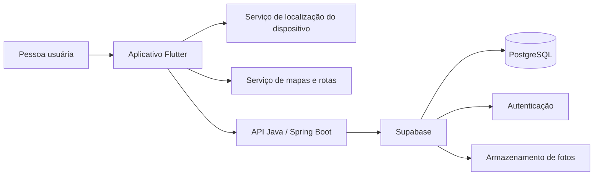

# Tech Stack – Mão na Roda

> **Versão do documento:** 0.3  
> **Data:** 13/10/2026  
> **Documentos relacionados:** [Visão de negócio](01-visao-de-negocio.md) · [Regras de negócio](02-regras-de-negocio.md) · [Requisitos](03-requisitos.md) · [Casos de uso](04-casos-de-uso.md)

---

## 1. Objetivo

Este documento registra as tecnologias previstas para a V1 do Mão na Roda, a responsabilidade de cada uma e as decisões que ainda precisam de validação.

A arquitetura da V1 prioriza uma implementação viável para uma equipe pequena: o aplicativo concentra a experiência da pessoa usuária; a API em Java concentra as regras de negócio; e o Supabase reduz o trabalho de infraestrutura ao oferecer banco PostgreSQL, autenticação e armazenamento de arquivos.

---

## 2. Visão geral da arquitetura

| Componente | Responsabilidade |
|---|---|
| Aplicativo Flutter | Exibir mapa, receber ações da pessoa usuária, solicitar permissões, apresentar rotas e permitir o envio de relatos. |
| API Java | Aplicar regras de negócio, calcular a classificação das barreiras, proteger operações autenticadas e integrar os serviços necessários. |
| Supabase | Fornecer PostgreSQL gerenciado, autenticação de contas e armazenamento das fotos enviadas em relatos. |
| Serviço de mapas e rotas | Fornecer mapa, busca de destinos, geocodificação e rotas-base entre origem e destino. |

---

## 3. Tecnologias

| Camada | Tecnologia | Papel no projeto | Status |
|---|---|---|---|
| Aplicativo móvel | Flutter e Dart | Desenvolver o aplicativo exclusivamente para Android, com interface acessível e suporte a localização. | Aprovado |
| Backend | Java com Spring Boot | Expor a API REST e centralizar as regras de rotas, relatos, contas e autorização. | Aprovado |
| API | REST com JSON | Permitir a comunicação entre o aplicativo e o backend. | Aprovado |
| Banco de dados | PostgreSQL, gerenciado pelo Supabase | Armazenar contas, perfis de mobilidade, relatos, confirmações futuras e dados de acessibilidade. | Aprovado |
| Autenticação | Supabase Auth | Criar contas, iniciar sessões e emitir tokens para acesso às operações autenticadas. | Aprovado |
| Armazenamento de fotos | Supabase Storage | Armazenar imagens anexadas aos relatos e removê-las após o prazo definido para contas excluídas. | Aprovado |
| Mapas, busca e rotas-base | Provedor a definir | Exibir mapa, localizar endereços e obter rotas entre dois pontos. | Pendente de validação |
| Localização | Recursos do dispositivo via pacote Flutter | Obter a localização atual somente após consentimento. | Aprovado |
| Documentação da API | OpenAPI/Swagger | Descrever e testar os endpoints da API. | Aprovado |
| Testes de backend | JUnit e Spring Boot Test | Validar regras de negócio, autenticação e endpoints. | Aprovado |
| Testes do aplicativo | Flutter Test | Validar componentes e fluxos essenciais do aplicativo. | Aprovado |
| Versionamento e CI | GitHub e GitHub Actions | Versionar o código e executar verificações automatizadas em Pull Requests. | Parcialmente aprovado |
| Monitoramento de falhas | Logs estruturados; ferramenta a definir | Identificar erros da API e do aplicativo em ambiente de teste ou produção. | Futuro / a definir |

---

## 4. Decisões de arquitetura

### 4.1 Flutter no aplicativo Android

O Flutter será usado para construir exclusivamente o aplicativo Android da V1. Ele permite desenvolver a interface, acessar a localização do dispositivo e integrar mapas.

O aplicativo não deve guardar segredos, chaves privadas ou dados sensíveis em texto legível. Tokens de sessão devem utilizar o mecanismo seguro disponível na plataforma, conforme os RNF08, RNF10, RNF16 e RNF19.

### 4.2 Java e Spring Boot no backend

O backend será uma API REST desenvolvida em Java com Spring Boot. Ele será responsável por:

- aplicar as regras de negócio de rotas e barreiras, especialmente RN01 a RN04;
- registrar e consultar relatos de acessibilidade;
- validar permissões das operações autenticadas;
- validar arquivos enviados antes de armazená-los;
- integrar o aplicativo ao Supabase e ao serviço de mapas e rotas;
- impedir que relatos não validados alterem automaticamente o cálculo da rota, conforme RN12.
- executar diariamente a rotina de descarte dos relatos e fotos de contas excluídas cujo prazo de retenção tenha expirado.

O backend é a fonte de verdade para regras de negócio e autorização. Restrições exibidas somente no aplicativo não são suficientes para proteger operações ou dados.

### 4.3 Supabase como infraestrutura gerenciada

O Supabase será usado para simplificar a infraestrutura da V1. Ele oferece PostgreSQL gerenciado, autenticação e armazenamento de arquivos no mesmo ambiente.

| Recurso do Supabase | Uso previsto |
|---|---|
| PostgreSQL | Dados de domínio do aplicativo, como perfis, relatos, localização associada ao relato, barreiras e metadados de verificação. |
| Auth | Criação de conta, login e emissão de tokens de sessão. A API Java deve validar esses tokens antes de executar operações protegidas. |
| Storage | Fotos anexadas aos relatos, após validação de formato, tamanho e remoção de metadados desnecessários. As imagens permanecem no Supabase e são removidas quando expira o prazo de retenção da RN16. |

O Supabase utiliza PostgreSQL; portanto, ele não é uma alternativa independente ao banco de dados, mas a plataforma que hospedará e administrará o PostgreSQL na V1.

#### Descarte automático após exclusão de conta

O backend Java executará diariamente uma rotina para identificar relatos de contas excluídas há mais de um mês. Para cada relato elegível, a rotina deve remover primeiro as fotos pela API do Supabase Storage e, em seguida, excluir o relato e seus metadados do PostgreSQL. Não será utilizado armazenamento externo, como Amazon S3 Glacier, na V1.

### 4.4 Mapas, destinos e rotas

O projeto depende de um provedor de mapas para quatro funções distintas:

1. Exibir o mapa no aplicativo.
2. Buscar destinos por texto e converter o resultado em coordenadas.
3. Converter coordenadas em referências de local, quando necessário.
4. Gerar rotas-base entre origem e destino.

O provedor ainda será escolhido após um protótipo técnico. A escolha deve considerar custo, limite de uso, cobertura em São Paulo, qualidade da busca de endereços, compatibilidade com Flutter e termos de uso.

> Uma rota-base fornecida por um serviço externo não será automaticamente considerada acessível. A API Java deverá combinar a rota-base com os dados de barreiras e o perfil de mobilidade para cumprir RN01 a RN04.

As fontes previstas para dados de acessibilidade são dados públicos, informações do OpenStreetMap quando disponíveis e relatos enviados pelos usuários. A origem e a data da última verificação devem ser registradas para atender RN06 e RN07.

---

## 5. Segurança e privacidade

As escolhas técnicas devem atender aos requisitos não funcionais já aprovados. A implementação detalhada será documentada junto ao código e à configuração de cada ambiente.

| Tema | Diretriz técnica inicial | Requisitos relacionados |
|---|---|---|
| Localização | Solicitar consentimento explícito no aplicativo e interromper a coleta quando a permissão for negada ou revogada. | RN14, RNF04 |
| Comunicação | Usar HTTPS/TLS entre aplicativo, API, Supabase e demais serviços remotos. | RNF11, RNF15 |
| Senhas | Delegar o armazenamento e o tratamento de senhas ao Supabase Auth; a API não deve persistir senhas. | RNF08 |
| Sessões | Validar tokens no backend, armazená-los com segurança no dispositivo e invalidá-los quando necessário. | RNF16, RNF17, RNF19 |
| Banco | Aplicar acesso com o menor privilégio necessário e consultas parametrizadas. | RNF09, RNF12 |
| Fotos | Validar conteúdo, formato e tamanho; remover metadados que não sejam necessários antes do armazenamento. Manter as fotos no Supabase Storage e removê-las pela rotina automática após o prazo da RN16. | RN16, RNF20 |
| Segredos | Guardar chaves e tokens em variáveis de ambiente ou serviço seguro; nunca versioná-los. | RNF10, RNF14 |

---

## 6. Implantação inicial

Para a V1, a infraestrutura será composta por:

| Item | Destino previsto | Observação |
|---|---|---|
| Aplicativo | Distribuição Android de teste | O aplicativo será desenvolvido e distribuído somente para Android na V1. A forma de distribuição será definida pela equipe durante o desenvolvimento. |
| API Java | Serviço de hospedagem compatível com aplicações Java | Provedor a escolher conforme custo, facilidade de configuração e suporte a HTTPS. |
| Banco, autenticação e fotos | Supabase | Ambiente separado para desenvolvimento e produção, quando houver publicação. |

---

## 7. Pendências e próximos passos

- [ ] Escolher e validar o provedor de mapas, busca de destinos e rotas-base.
- [ ] Fazer um protótipo que calcule uma rota-base e aplique as barreiras do perfil de mobilidade.
- [ ] Definir o modelo de dados inicial para perfis, barreiras, relatos e fotos.
- [ ] Definir limites de tamanho e formatos aceitos para as fotos.
- [ ] Escolher o serviço de hospedagem da API Java.
- [ ] Definir ambientes, variáveis de configuração e responsáveis pelos acessos ao Supabase.
- [ ] Configurar CI para executar testes e verificações em Pull Requests.
- [ ] Atualizar este documento quando as decisões pendentes forem aprovadas.

---

## Histórico de versões

| Versão | Data | Descrição |
|---|---|---|
| 0.1 | 13/10/2026 | Versão inicial da stack para a V1: Flutter, Java/Spring Boot e Supabase. |
| 0.2 | 13/10/2026 | Aprovação da stack proposta. |
| 0.3 | 13/10/2026 | Definição da retenção e do descarte automático de fotos no Supabase. |
