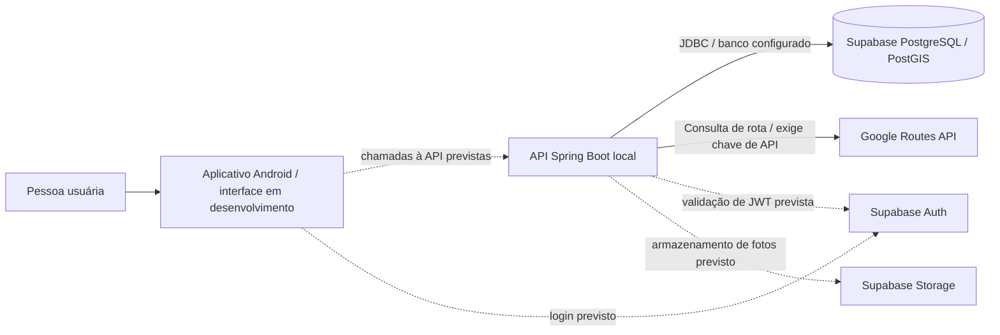
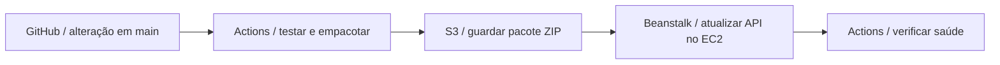
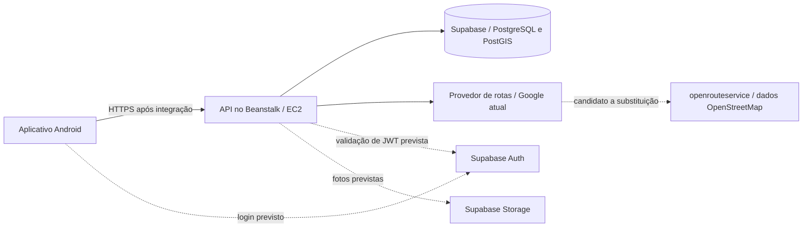

# Implantação da API com GitHub Actions e Elastic Beanstalk

Este documento é um ponto de partida para a implantação. A infraestrutura ainda
não foi provisionada. O fluxo de trabalho está em
`.github/workflows/api-beanstalk.yml`. Esta alteração não cria recursos na AWS.

## Implementação atual

As setas contínuas mostram dependências implementadas na API. As setas tracejadas
mostram integrações previstas, que ainda não compõem uma aplicação funcional de
ponta a ponta. Durante esta revisão, não foi encontrado um cliente de rede nos
arquivos Java do Android. O acesso ao banco exige configuração no ambiente de
execução; a validação de JWT do Supabase continua pendente. O armazenamento de
fotos está previsto.



## Proposta de implantação na AWS

A proposta tem dois fluxos independentes: publicar uma versão da API e atender
às pessoas que usam o aplicativo. O GitHub Actions participa apenas da publicação.

### Como uma nova versão chega à AWS

1. A equipe envia uma alteração da API ao GitHub.
2. O GitHub Actions executa os testes e gera o JAR da aplicação.
3. Após uma alteração chegar à branch main e passar nos testes, o fluxo envia
   um pacote ZIP ao S3. O S3 guarda o arquivo; ele não executa a API.
4. O Beanstalk usa esse pacote para atualizar a API na instância EC2.
5. O fluxo verifica se a versão publicada responde à consulta de saúde.



### Como o aplicativo acessa o sistema

O Android chama a API por HTTPS. A API consulta o banco no Supabase e solicita
rotas a um provedor externo. O Beanstalk administra o ambiente em que a API roda;
o EC2 é o servidor que executa o Java. Supabase Auth e Storage continuam previstos
para autenticação e fotos. As integrações pendentes aparecem tracejadas.



A seta entre provedores indica uma possível substituição, não uma chamada do
Google ao openrouteservice. A avaliação está descrita na seção de rotas abaixo.

**API Gateway é opcional.** Se adotado, fica entre o Android e a API. Não é
necessário para o GitHub Actions publicar versões e não está configurado pelo
fluxo atual. Para começar com menos componentes, a proposta é acesso HTTPS
direto à API. A validação de JWT continua sendo responsabilidade da aplicação.

Na instância única, configure domínio, certificado e renovação automática no
proxy reverso que recebe as requisições. O Beanstalk não torna esse endereço
HTTPS automaticamente. Um balanceador ALB com certificado ACM é outra opção,
mas acrescenta custo. Se adicionar Gateway depois, mantenha HTTPS também entre
ele e a API e impeça acesso direto que contorne os controles do Gateway.

## Configuração inicial na AWS

1. Escolha uma região. Compare o custo de hospedagem e a latência até os usuários
   e o banco do Supabase; os preços do Leste dos EUA diferem dos de São Paulo.
2. Crie uma aplicação no Beanstalk e um ambiente **Java SE Corretto 25 no Amazon
   Linux 2023, com uma única instância**, sem balanceador de carga. Essa opção
   apresenta indisponibilidade durante atualizações e não tem redundância.
   Configure a função de serviço do Beanstalk e o perfil de instância do EC2 pelo
   processo de criação de ambiente da AWS. Avalie o uso de memória da instância.
3. Crie um bucket privado no S3 para implantação, na mesma região. Habilite a
   criptografia e bloqueie o acesso público. Se usar um bucket próprio, conceda ao
   perfil de instância do Beanstalk permissão para ler os pacotes de implantação.
   Mantenha pacotes recentes para reversão; coordene as regras de ciclo de vida do
   S3 com a limpeza de versões da aplicação no Beanstalk.
4. Configure HTTPS conforme descrito acima. O Procfile define a porta do Spring
   como 5000, correspondente à porta de destino padrão do nginx na plataforma
   Java SE. Configure as verificações de saúde do ambiente para usar
   `/actuator/health`; permita acesso sem autenticação à resposta mínima de
   estado, sem expor outros endpoints do Actuator.
5. Configure as propriedades de execução pela integração de segredos do Beanstalk
   com Secrets Manager/SSM, concedendo permissões de leitura à função IAM do EC2.
   Considere os custos desses serviços. Informe `SPRING_DATASOURCE_URL`,
   `SPRING_DATASOURCE_USERNAME`, `SPRING_DATASOURCE_PASSWORD` e
   `GOOGLE_MAPS_API_KEY`; configure as propriedades de JWT quando a autenticação
   estiver implementada. Use TLS na conexão com o banco. Não envie `.env` ao
   GitHub nem ao S3.
6. Garanta conectividade de saída para Supabase e Google e configure um conjunto
   pequeno de conexões JDBC, respeitando os limites do Supabase. Se a chave do
   Google estiver restrita a um IP de saída, considere que a substituição da
   instância pode alterar esse IP.
7. Aplique e valide as migrations do banco **antes da primeira implantação**, com
   credenciais específicas para migrations e seguindo o README do banco. Este
   fluxo não executa Flyway, não provisiona PostgreSQL e não altera permissões do
   banco. Nas próximas versões, aplique migrations compatíveis com a versão
   anterior como pré-requisito controlado da implantação.

## OIDC e variáveis no GitHub

Crie um provedor OIDC no AWS IAM para `https://token.actions.githubusercontent.com`,
com o público-alvo (`audience`) `sts.amazonaws.com`. Crie uma função IAM de
implantação cuja política de confiança permita `sts:AssumeRoleWithWebIdentity`
somente para esse provedor, com as condições:

```json
{
  "StringEquals": {
    "token.actions.githubusercontent.com:aud": "sts.amazonaws.com",
    "token.actions.githubusercontent.com:sub": "repo:OWNER/REPOSITORY:environment:production"
  }
}
```

Substitua OWNER/REPOSITORY. Essas condições devem fazer parte de uma declaração
completa da política de confiança da função IAM, com o ARN do provedor como
identidade federada (`Principal.Federated`). Não configure chaves de acesso
permanentes da AWS no GitHub.

A função de implantação precisa de `PutObject` no S3 para o prefixo `api/*` do
bucket e das ações `CreateApplicationVersion`, `UpdateEnvironment` e
`DescribeEnvironments` do Beanstalk. Restrinja as ações que permitirem esse
controle à aplicação, às versões e ao ambiente de destino; ações de leitura ou
listagem podem exigir `Resource: *`. Permissões adicionais dependem da
criptografia do bucket e da configuração existente do ambiente. Essa função se
destina à implantação, não à administração da infraestrutura; não use
AdministratorAccess como atalho.

Crie um ambiente no GitHub chamado `production`, restrinja as branches de
implantação a `main` e, opcionalmente, exija um revisor se o plano do GitHub
permitir. Adicione estas **variáveis do ambiente** em
Settings → Environments → production:

| Variável | Exemplo / significado |
|---|---|
| `AWS_REGION` | `us-east-1` ou a região escolhida |
| `AWS_DEPLOY_ROLE_ARN` | ARN da função IAM de implantação usada pelo OIDC do GitHub |
| `EB_APPLICATION` | Nome da aplicação existente no Beanstalk |
| `EB_ENVIRONMENT` | Nome do ambiente existente |
| `EB_BUCKET` | Nome do bucket privado dos pacotes, sem `s3://` |
| `API_BASE_URL` | URL HTTPS pública de base, sem um caminho da API |

Este fluxo não exige segredos de execução do banco ou do Google no GitHub.
Proteja `main` e exija o job `verify`. PRs que alteram apenas o Android não
acionam este fluxo; evite tornar esse job com filtro por caminho uma verificação
obrigatória para todos os PRs sem uma estratégia adequada ao monorepositório.

## Comportamento do fluxo e pré-requisitos pendentes

- PRs e envios para main que alteram a API ou o fluxo executam Maven com Corretto 25.
- A execução manual também compila; a implantação só é permitida quando main é selecionada.
- `sh mvnw verify` precisa passar. O repositório documenta nove falhas HTTP 401
  nos testes de integração. Corrija a configuração de segurança e testes antes
  de esperar uma implantação. Nenhum teste é ignorado neste fluxo, e a suíte
  não foi validada novamente nesta entrega.
- Adicione cobertura de integração isolada com PostgreSQL/PostGIS conforme os
  testes do banco evoluírem; os testes atuais de repositório com H2 não validam
  as migrations reais.
- Somente uma compilação bem-sucedida de main envia à AWS o pacote com JAR e
  Procfile. O armazenamento de artefatos do GitHub também está sujeito às cotas
  do seu plano.
- Cada versão recebe um identificador único com SHA, execução e tentativa. As
  implantações são executadas uma por vez. O controle de concorrência do GitHub
  pode substituir uma implantação pendente mais antiga por uma mais recente.
- O job aguarda o Beanstalk, verifica a versão efetiva e a saúde Green e, depois,
  verifica se `/actuator/health` retorna `UP` por HTTPS. Isso não valida login nem
  Google Routes; adicione testes rápidos autenticados quando o contrato estiver
  implementado.
- Uma falha nessa verificação marca o job como malsucedido, mas **não reverte a
  implantação automaticamente**. No Beanstalk, implante a última versão da
  aplicação que funcionava e repita as verificações de saúde. Reverter a
  aplicação não reverte o banco de dados.

## Rotas e desvios com dados abertos

O código atual ainda chama Google Routes. A proposta é avaliar o
**openrouteservice hospedado, com dados do OpenStreetMap**, antes de substituir
essa integração. A troca não exige mudar o fluxo de implantação no Beanstalk.

### O que cada componente faz

| Componente | Responsabilidade |
|---|---|
| OpenStreetMap (OSM) | Fornece dados colaborativos de ruas, caminhos e características mapeadas. Não substitui sozinho um motor de cálculo de rotas. |
| openrouteservice (ORS) | Calcula rotas sobre esses dados e permite informar áreas a evitar por requisição. É o primeiro candidato para um protótipo. |
| API Java | Aplica o perfil de mobilidade e as regras do produto, seleciona obstáculos e solicita uma rota ao provedor. |
| Supabase / PostGIS | Guarda relatos e suas localizações; apoia consultas espaciais para relacionar obstáculos e trajetos. |
| Mapa no Android | Exibe o mapa e a rota. A biblioteca de visualização e o fornecedor das imagens ou dados do mapa precisam ser escolhidos separadamente. |

A documentação do ORS oferece `options.avoid_polygons`, que recebe áreas em
GeoJSON para evitar durante o cálculo. Também descreve restrições do perfil
`wheelchair`, como inclinação, largura e altura de guia. Isso torna o ORS um
candidato para o desvio solicitado, mas não comprova cobertura nem qualidade
de acessibilidade em São Paulo. Verifique a disponibilidade geográfica do perfil
na API hospedada; não presuma que todos os perfis documentados estejam disponíveis
no Brasil. Uma rota de pedestre não equivale a uma rota acessível.

### Exemplo: desviar de uma calçada bloqueada

1. Uma pessoa envia um relato com localização. A API o armazena no Supabase.
2. Ao consultar uma rota, o aplicativo mostra relatos próximos como avisos.
3. Para um relato ainda não validado, a pessoa escolhe explicitamente solicitar
   uma alternativa que evite aquele trecho, conforme a **RN12**.
4. A API relaciona a localização ao trecho afetado e monta uma pequena área de
   exclusão. O PostGIS pode apoiar essa operação; o tamanho e a geometria precisam
   de validação para não bloquear uma rua paralela ou a calçada oposta.
5. A API pede ao ORS outra rota usando essa área em `avoid_polygons` e verifica
   o resultado antes de apresentá-lo. Se não houver alternativa, informa essa
   condição; não apresenta a rota original como se tivesse evitado o obstáculo.

Os relatos permanecem no banco do aplicativo; não é necessário editar o mapa
público do OSM para solicitar esse desvio. Evitar polígonos é uma aproximação
espacial, não um mecanismo exato de bloqueio de uma aresta da rede. Uma área
mal posicionada pode não impedir a passagem ou excluir caminhos demais.

Na V1, relatos não validados **não alteram automaticamente** a rota. A RN09
prevê, para a V2, confirmação por três usuários autenticados distintos antes de
alterar a classificação do trecho. Essa confirmação ainda precisa ser implementada;
a mudança de provedor não muda as regras RN01–RN04, RN09 e RN12.

### Próximo passo e orçamento

Faça um protótipo pequeno na região Carrão–UNICID: compare a rota-base com uma
rota que evita um obstáculo selecionado, confira o desenho no mapa e valide
casos sem alternativa, origem próxima ao bloqueio e caminhos paralelos. Avalie
também a cobertura de calçadas, travessias e características de acessibilidade.
Não classifique uma rota como acessível apenas porque o provedor a calculou.

Priorize um serviço hospedado com plano gratuito disponível, após confirmar as
cotas e condições da conta. O ORS impõe limites às requisições e às áreas evitadas;
não trate o acesso como ilimitado nem fixe cotas neste documento sem conferência
no plano vigente. Mantenha a chave no backend e limite chamadas e recálculos.
Dados abertos e software livre não significam hospedagem gratuita ilimitada.

Não hospede um motor de rotas junto à API na pequena instância inicial. Construir
e manter grafos acrescenta consumo de memória, armazenamento e processamento,
que deve ser medido antes de comprometer os US$ 100 em créditos. Se o protótipo
não atender, avalie um motor próprio com recorte regional e suporte comprovado a
bloqueios dinâmicos, em uma etapa separada.

O mapa visual e a busca de endereços também precisam de fornecedores definidos.
Respeite a atribuição dos dados OSM e dos serviços utilizados. Os servidores
públicos de mapas do OSM têm política de uso e capacidade limitada; não são uma
infraestrutura gratuita irrestrita para o aplicativo.

## Controle de custos na AWS

Acompanhe o saldo e a validade dos US$ 100 em créditos. Configure alertas de
orçamento, retenção curta de logs e limpeza de versões. Evite NAT Gateway, RDS e
ambientes permanentes adicionais nesta etapa. Alertas de orçamento são
notificações, não limites que interrompem os gastos.

## Fontes

- [Plataformas compatíveis com Beanstalk](https://docs.aws.amazon.com/elasticbeanstalk/latest/platforms/platforms-supported.html)
- [Pacotes de código e Procfile na plataforma Java SE](https://docs.aws.amazon.com/elasticbeanstalk/latest/dg/java-se-platform.html)
- [OIDC do GitHub com AWS](https://docs.github.com/en/actions/how-tos/secure-your-work/security-harden-deployments/oidc-in-aws)
- [Opções de rotas do openrouteservice](https://giscience.github.io/openrouteservice/api-reference/endpoints/directions/routing-options)
- [Limites da API hospedada do openrouteservice](https://openrouteservice.org/restrictions/)
- [Política de uso dos mapas públicos do OpenStreetMap](https://operations.osmfoundation.org/policies/tiles/)
