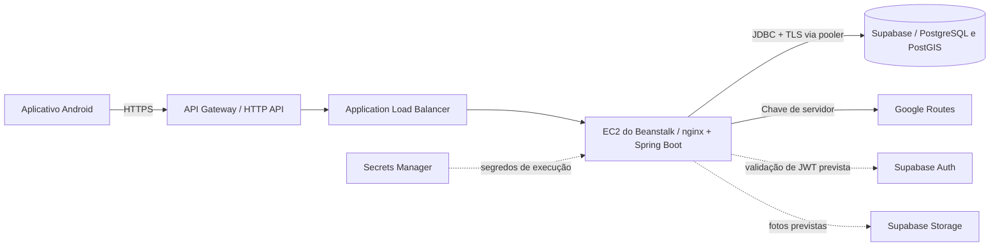
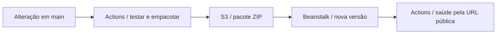

# Implantação da API na AWS

> **Última atualização:** 09/11/2026 <br>
> **Documentos relacionados:** [Tech stack](05-tech-stack.md) · [Banco de dados](06-banco-de-dados.md) · [Banco e migrations](../apps/api/database/README.md)

A API Spring Boot roda no **Elastic Beanstalk**, na região `us-east-2`, e é
publicada pelo GitHub Actions a cada alteração da API que chega à `main`. O
fluxo está em [`.github/workflows/api-beanstalk.yml`](../.github/workflows/api-beanstalk.yml).
O diagrama de componentes está no [README](../README.md#arquitetura-e-deploy).

## Arquitetura



| Componente | Função |
|---|---|
| API Gateway (HTTP API) | Ponto de entrada público. É a URL usada pelo aplicativo e pela verificação de saúde do deploy (`API_BASE_URL`). |
| Application Load Balancer | Recebe o tráfego do API Gateway e o encaminha à instância. |
| EC2 (t3.micro, Amazon Linux) | Instância gerenciada pelo Beanstalk; o nginx encaminha para o Spring na porta 5000 (definida no `Procfile`). |
| Secrets Manager | Credenciais do banco e chave do Google, lidas pelo ambiente do Beanstalk. |
| S3 | Bucket que recebe o pacote de cada versão. Guarda o arquivo; não executa a API. |
| IAM role | Assumida pelo GitHub Actions via OIDC, sem chaves de longa duração. |
| Supabase | PostgreSQL/PostGIS acessado por JDBC pelo pooler, com TLS verificado. |
| Google Routes | Candidatas de rota a pé; chamado somente pelo backend. |

As setas tracejadas são integrações ainda não concluídas: login real com
Supabase Auth e envio de fotos ao Storage.

## Fluxo de publicação



1. **verify** (PRs e `main`, quando `apps/api/**` ou o workflow mudam): sobe um
   PostgreSQL/PostGIS descartável, aplica e valida as migrations Flyway, executa
   `database/tests/integridade.sql` e `mvnw verify`. A suíte completa bloqueia a
   publicação.
2. O job empacota `application.jar`, `Procfile` e o certificado raiz do Supabase
   (`supabase-ca.crt`) em um ZIP.
3. **deploy** (somente `main`, ambiente `production`): assume a IAM role via OIDC,
   envia o ZIP ao S3, cria a versão no Beanstalk com identificador único
   (SHA, execução e tentativa) e atualiza o ambiente. Implantações rodam uma por vez.
4. O job aguarda o Beanstalk, confere a versão efetiva e a saúde `Green` e, por
   fim, exige que `${API_BASE_URL}/actuator/health` responda `UP`.
5. Em falha, etapas de diagnóstico mostram a resposta pelo API Gateway e direto
   pelo endereço do ambiente, eventos recentes do Beanstalk e o final dos logs da
   instância.

O fluxo **não** aplica migrations no banco de produção nem altera permissões do
banco. Uma falha na verificação de saúde marca o job como malsucedido, mas não
reverte a implantação: no Beanstalk, reimplante a última versão que funcionava.
Reverter a aplicação não reverte o banco de dados.

## Configuração do ambiente

### Variáveis de execução no Beanstalk

Configure pela integração do Beanstalk com o Secrets Manager/SSM, concedendo
leitura ao perfil de instância do EC2. Nunca envie `.env` ao GitHub nem ao S3.

| Variável | Uso |
|---|---|
| `SPRING_DATASOURCE_URL`, `SPRING_DATASOURCE_USERNAME`, `SPRING_DATASOURCE_PASSWORD` | Login da API no Supabase (pooler), herdando `maonaroda_api`. Ver [logins de execução](../apps/api/database/README.md#logins-de-execução). |
| `SPRING_PROFILES_ACTIVE=supabase` | Ativa Hikari, limites de conexão e `sslmode=verify-full`. |
| `SUPABASE_DB_CA_CERT` | Caminho absoluto do `supabase-ca.crt` incluído no pacote (no Beanstalk, a aplicação fica em `/var/app/current`). |
| `GOOGLE_ROUTES_API_KEY` | Chave de servidor restrita à Routes API. `GOOGLE_MAPS_API_KEY` é aceito como nome legado quando a nova variável estiver ausente. |
| `AUTH_ISSUER`, `AUTH_JWK_SET_URI`, `AUTH_AUDIENCE` | Validação de JWT das operações de conta. Sem elas, rotas e catálogo funcionam e operações protegidas recusam tokens. |

O nginx encaminha para a porta 5000 definida no `Procfile`. As verificações de
saúde do ambiente devem usar `/actuator/health`, que expõe apenas o estado mínimo.
Se a chave do Google estiver restrita a IP, lembre que a substituição da instância
pode alterar o IP de saída.

### Banco de dados

Migrations são aplicadas **antes** da implantação que depende delas, com
credenciais administrativas separadas e seguindo o
[guia do banco](../apps/api/database/README.md#aplicar-no-supabase). Produção foi
criada manualmente com um esquema equivalente a V1–V6 (`database/migrations`);
antes do primeiro `flyway:migrate` nela, registre o baseline conforme
[produção existente](../apps/api/database/README.md#produção-existente).
Novas migrations devem ser compatíveis com a versão anterior da API.

### OIDC e variáveis no GitHub

Crie um provedor OIDC no AWS IAM para `https://token.actions.githubusercontent.com`,
com o público-alvo `sts.amazonaws.com`. A função IAM de implantação deve permitir
`sts:AssumeRoleWithWebIdentity` somente para esse provedor, com as condições:

```json
{
  "StringEquals": {
    "token.actions.githubusercontent.com:aud": "sts.amazonaws.com",
    "token.actions.githubusercontent.com:sub": "repo:boregs/mao-na-roda:environment:production"
  }
}
```

Essas condições fazem parte de uma declaração completa da política de confiança,
com o ARN do provedor em `Principal.Federated`. Não configure chaves de acesso
permanentes da AWS no GitHub.

A função precisa de `PutObject` no prefixo `api/*` do bucket e das ações
`CreateApplicationVersion`, `UpdateEnvironment`, `DescribeEnvironments`,
`DescribeEvents`, `DescribeInstancesHealth`, `RequestEnvironmentInfo` e
`RetrieveEnvironmentInfo` do Beanstalk (as quatro últimas para o diagnóstico de
falhas). Restrinja-as à aplicação e ao ambiente de destino; não use
AdministratorAccess como atalho.

No GitHub, o ambiente `production` deve aceitar implantações apenas da `main`.
Variáveis do ambiente (Settings → Environments → production):

| Variável | Significado |
|---|---|
| `AWS_REGION` | Região do ambiente (`us-east-2`) |
| `AWS_DEPLOY_ROLE_ARN` | ARN da função IAM assumida via OIDC |
| `EB_APPLICATION` | Nome da aplicação no Beanstalk |
| `EB_ENVIRONMENT` | Nome do ambiente no Beanstalk |
| `EB_BUCKET` | Bucket privado dos pacotes, sem `s3://` |
| `API_BASE_URL` | URL HTTPS pública do API Gateway, sem caminho da API |

O fluxo não exige segredos de banco ou do Google no GitHub. Ele só é acionado
por alterações em `apps/api/**` ou no próprio workflow; PRs só do Android não o
executam, então não o torne verificação obrigatória para todos os PRs sem uma
estratégia adequada ao monorepositório.

## Controle de custos

Acompanhe o saldo e a validade dos créditos da AWS. Configure alertas de
orçamento, retenção curta de logs e limpeza de versões antigas da aplicação e
dos pacotes no S3 (mantendo as recentes para reversão). Alertas de orçamento são
notificações, não limites que interrompem os gastos. Evite NAT Gateway, RDS e
ambientes permanentes adicionais nesta etapa. Cada consulta real a
`/api/v1/rotas` também pode gerar cobrança no Google; o limite de consultas
públicas da API é local a cada instância, então avalie também uma cota no API Gateway.

## Fontes

- [Plataformas compatíveis com Beanstalk](https://docs.aws.amazon.com/elasticbeanstalk/latest/platforms/platforms-supported.html)
- [Pacotes de código e Procfile na plataforma Java SE](https://docs.aws.amazon.com/elasticbeanstalk/latest/dg/java-se-platform.html)
- [OIDC do GitHub com AWS](https://docs.github.com/en/actions/how-tos/secure-your-work/security-harden-deployments/oidc-in-aws)
