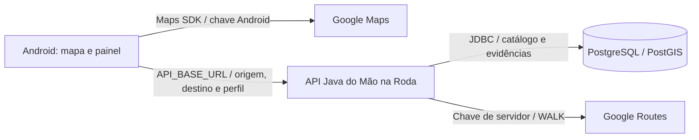

# Guia de testes de rotas para o time

Atualizado em **02/11/2026**. Repositório: [boregs/mao-na-roda](https://github.com/boregs/mao-na-roda).
Branch: `feat/planejamento-rotas-visitante`. [PR #22](https://github.com/boregs/mao-na-roda/pull/22).
Referência do código validado: `c3ac50f` (este guia é uma atualização posterior de documentação).

## O que falta para testar agora

O código está enviado e os testes automáticos passaram. Para calcular uma rota
real no Android Studio, ainda é necessário **preparar/conectar o banco, iniciar
a API e configurar o endereço dela no aplicativo**. Publicar a API não é
necessário para o teste no emulador do mesmo computador.

Inspeção da máquina de desenvolvimento em 02/11/2026, sem exibir credenciais:

| Item | Situação observada | Próxima ação |
|---|---|---|
| Código da integração | Enviado na branch indicada | Time atualizar a branch |
| `apps/api/.env` | Existe; `GOOGLE_ROUTES_API_KEY` preenchida | Confirmar faturamento e restrições com o responsável pelo Google Cloud; a chave ainda não foi validada em consulta real do novo fluxo |
| Três campos JDBC no `.env` | URL, usuário e senha vazios | Responsável pelo banco fornecer ambiente de desenvolvimento preparado e login da aplicação |
| API local | Nenhum serviço escutando na porta 8080 durante a inspeção | Iniciar o backend depois de configurar o banco |
| Android: SDK e chave Maps | Configuração local preenchida | Cada integrante configurar seu SDK e a chave Android autorizada para sua assinatura |
| Android: `API_BASE_URL` | Vazia no `local.properties` | Adicionar `http://10.0.2.2:8080` e recompilar em debug |
| Docker local | Comando indisponível no terminal inspecionado | Só é necessário preparar Docker se o time escolher o banco descartável local |
| API publicada | Ainda não publicada, conforme informado pelo responsável | Usar teste local; hospedagem HTTPS fica para outra etapa |

Esses estados são desta máquina, nessa data. Cada integrante precisa verificar
sua configuração; os arquivos com credenciais não são distribuídos pelo Git.
O APK instalado anteriormente recebeu a URL local por uma propriedade de build;
isso não preenche o `local.properties` para as próximas compilações no Studio.

## Responsabilidades e ordem de execução

| Ordem | Frente | Entrega necessária |
|---|---|---|
| 1 | Banco / DBA | Banco de desenvolvimento PostgreSQL/PostGIS, migrations V1–V6 aplicadas e login com grupo `maonaroda_api` |
| 2 | API / Google Cloud | Chave de servidor para Routes API, faturamento/restrições conferidos e `.env` configurado |
| 3 | API | Backend iniciado; saúde e catálogo funcionando; primeira chamada real a `/api/v1/rotas` registrada |
| 4 | Android | Branch atualizada, URL da API, chave Maps e assinatura debug configuradas; app executado no emulador |
| 5 | QA / produto | Validar os três perfis, os acessos/traçados, os avisos e os cenários abaixo; registrar resultado |

Os responsáveis nominais devem ser combinados pelo time.

## Como as partes se conectam



| Configuração | Onde fica | Para que serve |
|---|---|---|
| `GOOGLE_ROUTES_API_KEY` | `apps/api/.env` | Backend consultar Google Routes |
| `SPRING_DATASOURCE_URL`, `SPRING_DATASOURCE_USERNAME`, `SPRING_DATASOURCE_PASSWORD` | `apps/api/.env` | Backend acessar o banco |
| `API_BASE_URL` | `apps/android/local.properties` | App localizar a API do Mão na Roda; não é a URL do Google |
| `MAPS_API_KEY` | `apps/android/local.properties` | Desenhar o mapa com Maps SDK for Android |
| `sdk.dir` | `apps/android/local.properties` | Localização do Android SDK de cada computador |

A chave de servidor deve estar autorizada para **Routes API** e para o IP público
de saída do computador/servidor. O projeto Google precisa de faturamento ativo.
A chave Android deve estar autorizada para **Maps SDK for Android**, pacote
`com.maonaroda.mao_na_roda` e SHA-1 do certificado usado no teste. São configurações
separadas; não colocar a chave de servidor no app. Referências oficiais:
[Routes](https://developers.google.com/maps/documentation/routes/get-api-key) e
[Maps Android](https://developers.google.com/maps/documentation/android-sdk/get-api-key).

O fluxo atual não exige ORS, Places, uma API Geocoding separada, conta do usuário
ou JWT. Cadastro/login e relatos remotos não fazem parte deste teste de visitante.

## 1. Atualizar o projeto e conferir o ambiente

Na raiz do clone de cada integrante, preservando alterações locais:

```powershell
git fetch origin
git switch feat/planejamento-rotas-visitante
git pull --ff-only origin feat/planejamento-rotas-visitante
git rev-parse --short HEAD
```

Pré-requisitos:

- **API:** JDK 25 completo; usar o Maven Wrapper do projeto, sem instalar Maven separado.
- **Android:** Android Studio, SDK 35/build-tools 35.0.0 e emulador. Gradle usa
  **JDK 21**, com provisionamento automático configurado; código Android em Java 17.
- **Banco:** PostgreSQL com PostGIS preparado por uma das opções da seção 2.
- Internet para dependências, Google Maps e Google Routes.

O JDK do backend e o do Gradle são distintos. Não trocar o Gradle para JDK 25
por causa da API. O [README Android](../apps/android/README.md) cobre a sincronização.

## 2. Preparar o banco — escolher uma opção

### Opção A: banco de desenvolvimento já disponível

Pedir ao responsável pelo banco:

1. Host, porta, nome do banco, login e senha PostgreSQL da aplicação.
2. Confirmação de migrations **V1–V6** aplicadas/validadas pelo Flyway, PostGIS
   no schema esperado e catálogo dos três perfis carregado pela V4.
3. Login separado do administrador, herdando as permissões de `maonaroda_api`.
4. Configuração TLS/certificado para conexão remota.

A chave `anon`/publishable do Supabase não é senha JDBC. O usuário do Flyway é
separado do login da aplicação. O passo a passo administrativo está em
[banco e migrations](../apps/api/database/README.md#aplicar-no-supabase).
Não editar migrations já aplicadas nem executar os scripts de bootstrap local
em um projeto Supabase. O schema Auth real deve continuar gerenciado pelo provedor.

O `.env` não aplica migrations. `spring-boot:run` e `verify` também não as aplicam.
Para desenhar a primeira rota não é necessário publicar um dataset de barreiras;
as tabelas e o catálogo precisam existir. Sem evidências, a qualidade é desconhecida.

### Opção B: banco descartável no próprio computador

Requer Docker instalado, iniciado e acessível pelo terminal. Em `apps/api`, com
JDK 25 configurado, executar:

```powershell
.\tools\testar-postgis.ps1
```

O script inicia o PostgreSQL/PostGIS do `compose.test.yml`, prepara Auth simulado
somente para testes, aplica migrations, confere integridade e executa os testes.
Ele **não inicia a API**. Não serve para configurar um banco remoto/compartilhado.
O banco descartável fica em `127.0.0.1:55432`, nome `maonaroda_test`.

Depois de o script concluir sem erros, criar um login de execução nesse banco.
Abrir o terminal SQL do container:

```powershell
docker compose -f compose.test.yml exec postgres psql -U postgres -d maonaroda_test
```

Dentro do `psql`, executar uma vez:

```sql
CREATE ROLE maonaroda_local LOGIN INHERIT NOSUPERUSER NOCREATEDB NOCREATEROLE;
\password maonaroda_local
GRANT maonaroda_api TO maonaroda_local;
\q
```

`\password` pede e confirma uma senha sem colocá-la no comando. Se o login já
existir, reutilizá-lo; não repetir `CREATE ROLE` nem apagar o banco para contornar
o erro. Usar esse login e a senha escolhida no `.env`, não o administrador do Compose.
O Auth desse ambiente é uma fixture; ele não permite validar cadastro/login reais.

## 3. Configurar e iniciar a API

O arquivo deve ficar em **`apps/api/.env`**, ao lado de `pom.xml` e `mvnw.cmd`.
No computador original, o caminho completo é:

```text
C:\Users\tripl\AndroidStudioProjects\mao-na-roda\apps\api\.env
```

Na pasta `apps/api`, criar somente se ainda não existir:

```powershell
if (-not (Test-Path -LiteralPath .env)) { Copy-Item -LiteralPath .env.example -Destination .env }
```

Se o arquivo já existir, preservar a chave e completar os campos faltantes no
editor. Exemplo para a opção B; substituir os marcadores por valores locais:

```dotenv
GOOGLE_ROUTES_API_KEY=SUA_CHAVE_DE_SERVIDOR_ROUTES
SPRING_DATASOURCE_URL=jdbc:postgresql://127.0.0.1:55432/maonaroda_test
SPRING_DATASOURCE_USERNAME=maonaroda_local
SPRING_DATASOURCE_PASSWORD=SENHA_ESCOLHIDA_NO_PASSO_ANTERIOR
```

Para a opção A, usar a URL, porta, login, senha e TLS do banco fornecido pelo DBA.
O arquivo é lido como propriedades Java: usar `NOME=valor`, sem aspas, `export`
ou expansão de variáveis. Preferir `/` em caminhos de certificado no Windows;
barras invertidas literais precisam ser escapadas conforme o formato properties.
Manter `.env` e `local.properties` fora do Git e da mensagem para o time.

Ainda em `apps/api`, iniciar o backend em um terminal dedicado:

```powershell
$env:JAVA_HOME = 'C:\caminho\real\para\jdk-25'
.\mvnw.cmd --version
.\mvnw.cmd "-Dspring-boot.run.profiles=local" spring-boot:run
```

Substituir o caminho do JDK; o wrapper deve indicar Java 25. Manter o terminal
aberto. O perfil `local` escuta em `127.0.0.1`; a porta padrão é 8080, alterável
por `PORT`. Iniciar a partir de `apps/api`, pois o `.env` é procurado na pasta
de execução. Reiniciar o backend após alterar o `.env`.

## 4. Validar o backend antes de abrir o app

Em outro PowerShell, verificar (sem chamada paga ao Google):

```powershell
Invoke-RestMethod -Uri 'http://127.0.0.1:8080/actuator/health'
Invoke-RestMethod -Uri 'http://127.0.0.1:8080/api/v1/perfis-mobilidade'
```

Esperado: saúde `UP` e catálogo com `cadeirante`, `muleta_ou_outro_auxilio` e
`mobilidade_reduzida`. Falha aqui deve ser resolvida antes de consultar uma rota.
Esses dois endpoints não validam a chave Google.

Para testar o fluxo real completo do backend, executar **uma** consulta de rota
com locais públicos. Esta chamada usa Google Routes e pode consumir cota/cobrança:

```powershell
$pedidoRota = @{
    origem = @{ endereco = 'Estação de Metrô Carrão, São Paulo, SP, Brasil' }
    destino = @{ endereco = 'UNICID, Rua Cesário Galeno, 448, São Paulo, SP, Brasil' }
    perfil = 'cadeirante'
} | ConvertTo-Json -Depth 4
$respostaRota = Invoke-RestMethod -Uri 'http://127.0.0.1:8080/api/v1/rotas' -Method Post -ContentType 'application/json; charset=utf-8' -Body ([System.Text.Encoding]::UTF8.GetBytes($pedidoRota))
$respostaRota | ConvertTo-Json -Depth 20
```

Alternativa: `http://127.0.0.1:8080/swagger-ui/index.html`, operação
**POST `/api/v1/rotas`**. Não usar `/rotas/base` como comprovação do planejamento
avaliado: esse endpoint tem outro contrato e não exercita a avaliação de evidências.

| Campo/resultado | Conferência |
|---|---|
| HTTP | 200 e JSON do planejamento, sem precisar de conta/token |
| `rotas` | Uma a três candidatas para esse teste, quando houver cobertura do Google; não exigir exatamente três |
| `geometria` | `LineString` com coordenadas `[longitude, latitude]` e pelo menos dois pontos |
| Métricas | Distância em metros e duração em segundos; não comparar com valores fixos antigos |
| Sem dataset ativo | `versaoEvidencias: SEM_DATASET`, `resultado: PARCIAL`, qualidade `DESCONHECIDA` e cobertura 0 nas candidatas |
| Avisos | Dados ausentes não garantem acessibilidade; limitações da caminhada Google presentes |
| `SEM_CANDIDATA` | Resultado de ausência de rota, sem inventar caminho; não comprova o cálculo bem-sucedido de uma candidata |

Se o backend retornar uma candidata, a configuração Routes funcionou para essa
consulta. A inspeção do acesso real e do traçado ainda é necessária no mapa.
Sem dados revisados de barreiras, não exigir mudança de traçado entre perfis:
os perfis classificam evidências locais, e o provedor recebe `WALK` em todos eles.

## 5. Configurar e executar no Android Studio

Abrir **`apps/android`** como projeto. Em **`apps/android/local.properties`**,
preservar `sdk.dir` e a chave Maps existente e adicionar/ajustar:

```properties
API_BASE_URL=http://10.0.2.2:8080
MAPS_API_KEY=SUA_CHAVE_ANDROID_MAPS
```

Neste computador, o arquivo está em:

```text
C:\Users\tripl\AndroidStudioProjects\mao-na-roda\apps\android\local.properties
```

`10.0.2.2` é o endereço usado pelo emulador para alcançar o computador. `localhost`
dentro do Android aponta para o próprio Android. Essa distinção é descrita na
[documentação do emulador](https://developer.android.com/studio/run/emulator-networking-address).
Se mudar a porta da API, atualizar a URL e os comandos de teste também.

1. Sincronizar o Gradle. Confirmar JDK 21 para o Gradle e concluir o download
   automático do JDK, se solicitado pela sincronização.
2. Selecionar a configuração **app**, variante **debug**, e iniciar o emulador.
3. Clicar em **Run**. Não selecionar `VisitorJourneyTest`: ele executa um teste
   e fecha a tela ao terminar. “Map with Marker” é outro aplicativo/pacote.
4. Entrar sem conta e expandir o painel de planejamento.
5. Selecionar um perfil, informar os mesmos endereços do teste HTTP e tocar em
   **Consultar rota**. Endereços completos com cidade reduzem ambiguidades.
6. Conferir a linha no mapa, origem/destino, distância/tempo, cobertura e detalhes.
   Verificar que não há indicação automática de “rota acessível”.

As coordenadas manuais usam `latitude, longitude`, com ponto nos decimais.
Não há autocomplete nem busca separada nesta versão. Cada consulta real no app
também pode consumir cota do Google. Se alterar `local.properties`, sincronizar
e executar novamente para recompilar os valores incorporados ao aplicativo.

Para dispositivo por USB, pode-se usar `adb reverse tcp:8080 tcp:8080` e
`API_BASE_URL=http://127.0.0.1:8080` em debug. HTTP é limitado a `localhost`,
`127.0.0.1` e `10.0.2.2`; IP da rede Wi-Fi não está liberado. Release exige HTTPS.
Um backend local não fica disponível para todo o time pela URL `10.0.2.2`:
cada integrante executa no próprio computador, ou o time usa uma API HTTPS publicada.

## 6. Roteiro de aceite manual

| Caso | Ação | Resultado a registrar |
|---|---|---|
| T01 — Catálogo | Abrir planejamento e selecionar perfil | Três perfis disponíveis; sem exigir cadastro |
| T02 — Endereços | Consultar Carrão → UNICID com endereço completo | Candidata e linha coerentes; métricas e avisos legíveis |
| T03 — Três perfis | Repetir T02 em cada perfil | Consulta funciona; qualidade/evidências expostas; não exigir trajetos diferentes sem dados |
| T04 — Coordenadas | Informar locais distintos por `latitude, longitude` ou misturar endereço/coordenada | Consulta aceita sem inverter latitude/longitude no mapa |
| T05 — Entrada inválida | Deixar destino vazio ou digitar `91, -46` | Validação visível; app não fecha nem inventa rota |
| T06 — Sem backend/rede | Parar API e tentar consulta; depois reiniciar | Erro visível e possibilidade de nova tentativa |
| T07 — Cancelar/editar | Cancelar ou alterar o destino durante consulta | Resposta antiga não substitui a consulta atual |
| T08 — Recriação | Recriar/girar a tela após consulta | Estado preservado durante a sessão; conteúdo acessível por rolagem |
| T09 — Localização negada | Negar localização e usar entrada manual | Planejamento manual continua disponível |
| T10 — Interface | Conferir tema claro/escuro, texto ampliado e teclado | Botões, mensagens e detalhes alcançáveis, sem sobreposição nas barras |

Critério mínimo para marcar **teste funcional de rotas aprovado**: saúde e
catálogo funcionando, pelo menos uma candidata real no endpoint avaliado e no
mapa, teste dos três perfis, avisos presentes e falhas tratadas sem fechamento
inesperado. Isso não homologa acessibilidade física, tempo/custo em produção ou
contas/relatos. Evidências piloto precisam de revisão sobre o traçado Google;
não transferir associações ORS por proximidade.

## 7. O que já foi validado

| Verificação | Resultado / evidência |
|---|---|
| API local anterior | 51 testes: 48 aprovados e 3 PostGIS ignorados por falta do ambiente local |
| API no GitHub, código `c3ac50f` | **51 testes aprovados, nenhum ignorado**; preparação PostGIS, migrations e integridade aprovadas. [Execução](https://github.com/boregs/mao-na-roda/actions/runs/41534145042) |
| Publicação da API nessa execução | **Não executada**; etapa deploy ignorada. CI aprovado não significa API hospedada |
| Android no GitHub, código `c3ac50f` | Build, lint, testes unitários e geração do APK de testes aprovados. [Execução](https://github.com/boregs/mao-na-roda/actions/runs/41534145166) |
| Android local anterior | **18 testes unitários e 3 instrumentados aprovados**, emulador Pixel 9 API 37.1; debug instalado e iniciado |
| Lint local anterior | Sem erros; 94 avisos de recursos/layout/textos/configuração, com limpeza pendente |
| Rede debug/release | HTTP local testado no emulador; release recusou HTTP; manifesto release com HTTPS não inclui a exceção debug |
| Google real no novo planejamento | **Pendente**; as consultas automáticas usam simuladores, sem custo Google |
| Revisão visual completa e campo | **Pendentes**; os testes instrumentados não substituem esse aceite |

Os três testes PostGIS ignorados localmente já passaram no CI; não são uma falha
do código. O banco usado pelo CI é descartável e não vira o banco do aplicativo.
O CI Android compila o APK instrumentado, mas não executa um emulador nesse workflow.
A execução dos três testes instrumentados citada acima foi local.

Para reproduzir sem chamar Google, na pasta correspondente:

```powershell
# apps/api, JDK 25: testes sem exigir banco externo; PostGIS será ignorado sem TEST_POSTGIS_*.
.\mvnw.cmd --batch-mode --no-transfer-progress verify
# apps/api, JDK 25 e Docker: inclui migrations, integridade e testes PostGIS.
.\tools\testar-postgis.ps1
# apps/android, Gradle/JDK 21:
.\gradlew.bat :app:assembleDebug :app:assembleDebugAndroidTest :app:lintDebug :app:testDebugUnitTest
# apps/android, emulador de teste conectado: executa e encerra a aplicação de teste.
.\gradlew.bat :app:connectedDebugAndroidTest
```

Usar um emulador de teste: a execução instrumentada gerencia a instalação do app
e dados de teste. Testes automáticos aprovados não substituem a seção 6.

## 8. Diagnóstico rápido

| Sintoma | Verificar |
|---|---|
| `.env` não aparece no Studio | Ele fica em `apps/api`, fora do projeto Android aberto; abrir a pasta pelo Explorador/editar arquivo existente |
| API não inicia / DataSource ausente | Três campos JDBC preenchidos, JDK 25, pasta de execução e banco acessível |
| Saúde não está `UP` / catálogo falha | Banco, permissões e migrations; ainda não é diagnóstico da chave Google |
| Mapa aparece, mas não há perfis/rotas | `API_BASE_URL`, backend rodando e catálogo; Maps e backend são serviços distintos |
| Mapa vazio com erro de autorização | Maps SDK habilitado, chave Android, pacote e SHA-1 do computador do testador |
| HTTP 400 | Locais/perfil inválidos, dados ausentes ou mistura de endereço/coordenadas no mesmo ponto |
| HTTP 401 | Consulta de visitante não exige token; remover um Bearer inválido de testes manuais. Contas exigem JWT |
| HTTP 410 em `/destinos/busca` | Endpoint antigo retirado; enviar endereço diretamente para `/api/v1/rotas` |
| HTTP 429 | Limite local de 30 consultas públicas/minuto por endereço; aguardar a janela |
| HTTP 502 | Falha/resposta inválida do provedor; revisar chave Routes, faturamento, restrições e locais. Corpo privado do Google não é exposto |
| HTTP 503 | Banco/serviço indisponível, chave ausente ou cota externa; conferir primeiro saúde/catálogo e depois configuração Routes |
| HTTP 504 | Prazo de consulta excedido; conferir rede e serviços antes de tentar novamente |
| App fecha após “Run” | Conferir se a configuração é **app**, e não o teste; se houver crash real, registrar exceção/stack trace do Logcat |
| Rota com qualidade desconhecida | Pode ser o resultado correto sem evidências revisadas; não equivale a erro de conexão nem ausência de barreiras |

## 9. Registro para o time preencher

```text
Data e responsável:
Commit testado (git rev-parse --short HEAD):
Ambiente do banco (apenas nome/identificação, sem senha):
JDK API / JDK Gradle:
Emulador ou aparelho / versão Android:
Saúde UP e catálogo com três perfis: sim/não
POST /api/v1/rotas: HTTP ___ / resultado ___ / candidatas ___
Perfis testados:
Linha, origem e destino conferidos no mapa: sim/não
Qualidade/cobertura e avisos conferidos: sim/não
Casos T01–T10 aprovados/falhas/não executados:
Erro encontrado e passos para reproduzir:
Evidência sem chave/token/senha ou localização pessoal:
Conclusão: aprovado / reprovado / bloqueado por configuração
Pendência e responsável pelo próximo passo:
```

Não marcar como testado o que não foi executado. A publicação HTTPS, integração
de identidade, relatos remotos/fotos e validação de acessibilidade em campo
continuam etapas próprias. O PR permanece para revisão humana conforme
[CONTRIBUTING.md](../CONTRIBUTING.md); testar a branch não exige fazer merge.

Detalhes da mudança: [registro 16](16-migracao-google-routes.md).
Contrato e limites: [planejamento da API](../apps/api/PLANEJAMENTO.md).
